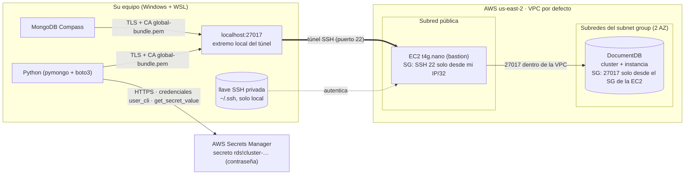

# Diagrama de conexión: MongoDB Compass / Python → DocumentDB



## Lectura paso a paso

```
 Compass / Python                                                 AWS (us-east-2)
┌───────────────┐   TLS (valida con global-bundle.pem)
│ localhost:27017│──────────────┐
└───────────────┘              │   Túnel SSH, puerto 22
                               └────────────────────────▶ ┌───────────────────────┐
  llave SSH (local) ──────── autentica ───────────────▶  │ EC2 bastion t4g.nano  │
                                                          │ SG: 22 solo desde mi IP│
                                                          └──────────┬────────────┘
                                                                     │ 27017 (red interna de la VPC)
                                                                     ▼
                                                          ┌───────────────────────┐
                                                          │ DocumentDB (sin IP    │
                                                          │ pública)              │
                                                          │ SG: 27017 solo desde  │
                                                          │ el SG de la EC2       │
                                                          └───────────────────────┘

  Python ──HTTPS (user_cli)──▶ Secrets Manager ──▶ usuario y contraseña (en memoria, nunca en el código)
```

| Qué | Por qué es necesario |
|---|---|
| Túnel SSH | DocumentDB no tiene endpoint público; la única ruta es desde dentro de la VPC |
| SG de la EC2 (22 desde mi IP/32) | Solo mi equipo puede abrir el túnel |
| SG de DocumentDB (27017 desde el SG de la EC2) | Solo el bastion puede hablar con la base |
| `global-bundle.pem` | DocumentDB usa TLS con certificados de la CA de Amazon |
| `tlsAllowInvalidHostnames` | El cliente conecta a `localhost` y el certificado es del endpoint del cluster |
| `directConnection=true`, `retryWrites=false` | Una sola ruta (el túnel) y motor 5.0.0 sin retryable writes |
| Secrets Manager | La contraseña se recupera en ejecución; no se escribe en código ni en archivos |
